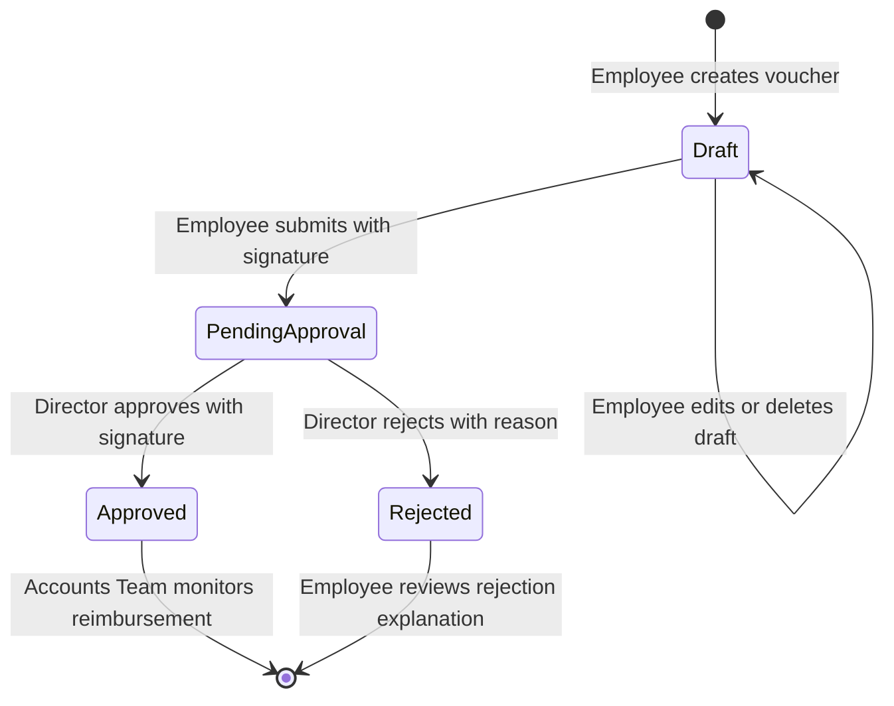

# PSPL Expense Voucher Management System

A production-ready Full Stack MERN application developed for **Prachay Securities Private Limited (PSPL)** for evaluating Full Stack Developer Internship candidates.

The application manages the end-to-end employee expense reimbursement lifecycle—from drafting claims, digital signature attachment, and Director executive approval/rejection workflows to Accounts Team reimbursement audit monitoring.

---

## 1. Project Overview

Prachay Securities Private Limited (PSPL) requires a centralized corporate expense voucher management platform. The system enforces strict role-based access control (RBAC), multi-step voucher state transitions, tamper-proof uniqueness for voucher numbering, and digital signature uploads using Multer and HTML5 canvas pads.

---

## 2. Features

- **Role-Based Portals:** Dedicated dashboards and custom views tailored for **Employee**, **Director**, and **Accounts Team**.
- **Idempotent Database Seeding:** Seed demonstration accounts and initial vouchers with zero duplication on repeated executions.
- **Atomic Voucher Numbering:** Sequential voucher IDs (`EXP-YYYY-XXXX`) generated atomically via MongoDB counters to prevent collisions even under high concurrency.
- **Draft & Submission Lifecycle:**
  - Create drafts without signatures.
  - Edit or delete drafts at will.
  - Strict submission validation requiring all mandatory details and employee signatures.
  - Post-submission state locks vouchers as read-only to employees.
- **Executive Director Approval & Rejection:**
  - Director approval requires a mandatory Director signature.
  - Director rejection requires a mandatory rejection reason permanently visible to the employee.
  - Single-decision enforcement: vouchers cannot be approved or rejected multiple times.
  - Zero modification of employee-entered expense details by executives.
- **Accounts Team Financial Ledger:**
  - Live pipeline tracking approved expense totals and recent approvals.
  - Read-only audit access across all organization-wide vouchers.
- **Dual Signature Input:** Upload image files (JPEG, PNG, WebP ≤ 2MB) or draw interactive digital signatures on an HTML5 canvas.
- **Search, Multi-Filter & Sorting:**
  - Search by voucher number or employee name.
  - Filter by department, expense category, voucher status, date range, and amount range.
  - Sort by newest, oldest, amount (low-to-high, high-to-low).
  - Clear filters button to instantly reset all query parameters.
- **Printable Vouchers:** Clean CSS print styles for voucher record printouts.

---

## 3. Technology Stack

### Frontend
- **Framework:** React.js (via Vite)
- **Language:** JavaScript (JSX only — no TypeScript)
- **Styling:** Plain CSS with custom design tokens, dark navy sidebar, cards, and responsive layouts (no Tailwind, no Bootstrap)
- **Routing:** React Router v7 (`react-router-dom`)
- **HTTP Client:** Axios with centralized interceptors for JWT token injection and 401 redirect handling

### Backend
- **Runtime:** Node.js (v24+)
- **Framework:** Express.js (v5+)
- **Database:** MongoDB & Mongoose (v9+)
- **Authentication:** JSON Web Tokens (`jsonwebtoken`) & `bcryptjs`
- **File Uploads:** Multer with MIME validation and 2MB file size limits
- **CORS:** Cross-Origin Resource Sharing enabled

---

## 4. Prerequisites

Before running the application locally, ensure you have:
1. **Node.js**: v18.x, v20.x, or v24.x installed (`node -v`)
2. **npm**: v9.x or higher (`npm -v`)
3. **MongoDB**: Local MongoDB community server running on port `27017` (e.g. `mongodb://127.0.0.1:27017`) or a MongoDB Atlas URI

---

## 5. Project Folder Structure

```
Expense Voucher Management System/
├── backend/
│   ├── config/
│   │   └── db.js                 # Mongoose connection setup
│   ├── controllers/
│   │   ├── authController.js      # Login and user profile logic
│   │   ├── dashboardController.js # Aggregations for 3 dashboards
│   │   └── voucherController.js   # CRUD & approval workflows
│   ├── middleware/
│   │   ├── auth.js               # JWT protect & role authorize
│   │   └── upload.js             # Multer config (2MB, JPEG/PNG/WebP)
│   ├── models/
│   │   ├── Counter.js            # Atomic sequence generator
│   │   ├── User.js               # User schema with bcrypt hashing
│   │   └── Voucher.js            # Voucher schema and indexes
│   ├── routes/
│   │   ├── authRoutes.js         # /api/auth
│   │   ├── dashboardRoutes.js    # /api/dashboard
│   │   ├── uploadRoutes.js       # /api/upload
│   │   └── voucherRoutes.js      # /api/vouchers
│   ├── scripts/
│   │   ├── seed.js               # Idempotent DB seeder
│   │   └── test_api.js           # 19 automated integration tests
│   ├── uploads/                  # Uploaded signature images
│   ├── .env                      # Local environment configuration
│   ├── .env.example              # Environment variables template
│   ├── package.json              # Backend dependencies and scripts
│   └── server.js                 # Express server entry point
├── frontend/
│   ├── public/
│   ├── src/
│   │   ├── components/
│   │   │   ├── ApprovalModal.jsx # Director approve/reject modal
│   │   │   ├── ConfirmModal.jsx  # Reusable confirmation dialog
│   │   │   ├── FilterBar.jsx     # Search, filter & sort controls
│   │   │   ├── ProtectedRoute.jsx# Auth and RBAC route wrapper
│   │   │   ├── SignatureUpload.jsx# File upload & Canvas pad
│   │   │   ├── StatCard.jsx      # Dashboard KPI cards
│   │   │   ├── StatusBadge.jsx   # Draft/Pending/Approved/Rejected
│   │   │   └── VoucherTable.jsx  # Reusable vouchers data table
│   │   ├── context/
│   │   │   └── AuthContext.jsx   # User session and auth state
│   │   ├── layouts/
│   │   │   └── AppLayout.jsx     # Sidebar, topbar, mobile drawer
│   │   ├── pages/
│   │   │   ├── AccountsDashboard.jsx
│   │   │   ├── AllVouchersPage.jsx
│   │   │   ├── CreateVoucherPage.jsx
│   │   │   ├── DirectorDashboard.jsx
│   │   │   ├── EditVoucherPage.jsx
│   │   │   ├── EmployeeDashboard.jsx
│   │   │   ├── LoginPage.jsx
│   │   │   ├── MyVouchersPage.jsx
│   │   │   ├── NotFoundPage.jsx
│   │   │   ├── PendingApprovalsPage.jsx
│   │   │   └── VoucherDetailsPage.jsx
│   │   ├── services/
│   │   │   └── api.js            # Axios client with interceptors
│   │   ├── styles/
│   │   │   ├── components.css    # Cards, tables, forms, buttons
│   │   │   ├── layout.css        # Layouts, sidebar, topbar
│   │   │   ├── main.css          # Master stylesheet
│   │   │   └── variables.css     # Design tokens and colors
│   │   ├── App.jsx               # React Router route registry
│   │   ├── index.css             # Entry stylesheet
│   │   └── main.jsx              # React DOM render root
│   ├── index.html
│   ├── package.json
│   └── vite.config.js            # Vite configuration with /api proxy
├── .gitignore
└── README.md
```

---

## 6. Installation Instructions

### Step 1: Clone or Navigate to the Workspace
```bash
cd "e:/Expense Voucher Management System"
```

### Step 2: Install Backend Dependencies
```bash
cd backend
npm install
```

### Step 3: Install Frontend Dependencies
```bash
cd ../frontend
npm install
```

---

## 7. MongoDB Configuration

Ensure your MongoDB instance is running locally:
```bash
# Verify MongoDB service status on Windows:
Get-Service -Name MongoDB
```
If using a custom URI or cloud MongoDB Atlas, update `MONGODB_URI` in `backend/.env`.

---

## 8. Environment Variable Configuration

Create or inspect `backend/.env` (a template is available in `backend/.env.example`):
```env
PORT=5000
MONGODB_URI=mongodb://127.0.0.1:27017/expenseVoucherDB
JWT_SECRET=prachay_securities_expense_voucher_jwt_secret_key_2026_super_secure
JWT_EXPIRES_IN=1d
NODE_ENV=development
```

---

## 9. Seed Demonstration Users

Populate the database with the required demonstration accounts and sample vouchers:
```bash
cd backend
npm run seed
```
*(The script is idempotent: running it multiple times safely updates records without creating duplicates).*

---

## 10. Start the Application

### Start the Backend Server:
```bash
cd backend
npm run dev
# Server will run at http://localhost:5000
```

### Start the Frontend Dev Server:
```bash
cd frontend
npm run dev
# Frontend will run at http://localhost:5173
```

Open `http://localhost:5173` in your browser.

---

## 11. Demonstration Login Credentials

For local testing and reviewer evaluation, the seed script provisions three pre-configured accounts:

| Role | Name | Email Address | Password |
|---|---|---|---|
| **Employee** | Rahul Sharma | `employee@prachay.com` | `Password@123` |
| **Director** | Ananya Deshmukh | `director@prachay.com` | `Password@123` |
| **Accounts Team** | Vikram Patel | `accounts@prachay.com` | `Password@123` |

> **Pro-Tip:** The login screen provides **Quick Demo Account** buttons to instantly fill in any of the above credentials with a single click.

---

## 12. Database Schema Explanation

### User Schema (`models/User.js`)
- `name`: String, required, trimmed
- `email`: String, required, unique, lowercase
- `password`: String, required (hashed using bcrypt with 10 salt rounds; never exposed in API output)
- `role`: String enum (`'Employee'`, `'Director'`, `'Accounts Team'`)
- `employeeId`: String (e.g. `'PSPL-EMP-1042'`)
- `createdAt`: Date

### Counter Schema (`models/Counter.js`)
- `_id`: String (e.g. `'voucher_2026'`)
- `seq`: Number
- Method: `getNextVoucherNumber(year)` uses atomic `findByIdAndUpdate` with `$inc` to produce format `EXP-YYYY-XXXX`.

### Voucher Schema (`models/Voucher.js`)
- **Basic Info:**
  - `voucherNumber`: String, unique, uppercase (e.g. `EXP-2026-0001`)
  - `voucherDate`: Date, default `Date.now`
  - `expenseDate`: Date, required
  - `departmentName`: String, required
  - `expenseTitle`: String, required
  - `expenseCategory`: String enum (`'Travel'`, `'Food'`, `'Accommodation'`, `'Office Supplies'`, `'Transportation'`, `'Other'`)
  - `expenseDescription`: String
  - `amount`: Number, required, minimum 0.01
- **Employee Info:**
  - `employee`: ObjectId ref `User`, required
  - `employeeName`: String, required
  - `employeeId`: String
  - `employeeSignature`: String URL (e.g. `/uploads/sig-xxxx.png`)
- **Approval Info:**
  - `status`: String enum (`'Draft'`, `'Pending Approval'`, `'Approved'`, `'Rejected'`), default `'Draft'`
  - `director`: ObjectId ref `User`, default `null`
  - `directorName`: String, default `null`
  - `directorSignature`: String URL, default `null`
  - `approvalDate`: Date, default `null`
  - `rejectionReason`: String, default `null`
- **Audit Info:**
  - `timestamps`: `createdAt`, `updatedAt`

---

## 13. API Documentation

### Authentication (`/api/auth`)
- `POST /api/auth/login`: Authenticate email and password, returns JWT token and safe user payload.
- `GET /api/auth/me`: Validate JWT token and fetch active user session.

### Vouchers (`/api/vouchers`)
- `GET /api/vouchers`: List vouchers with search (`search`), filters (`department`, `category`, `status`, `startDate`, `endDate`, `minAmount`, `maxAmount`), and sorting (`sortBy`). Automatically scoped to `req.user._id` for Employees.
- `GET /api/vouchers/:id`: Retrieve single voucher details. Enforces ownership for Employees.
- `POST /api/vouchers`: Create draft voucher (Employee only).
- `PUT /api/vouchers/:id`: Update draft voucher (Employee only; restricted to Draft status).
- `DELETE /api/vouchers/:id`: Delete draft voucher (Employee only; restricted to Draft status).
- `POST /api/vouchers/:id/submit`: Submit draft voucher for approval (validates signature, department, title, date, amount > 0).
- `POST /api/vouchers/:id/approve`: Approve pending voucher (Director only; validates Director signature).
- `POST /api/vouchers/:id/reject`: Reject pending voucher (Director only; validates rejection reason).

### Dashboards (`/api/dashboard`)
- `GET /api/dashboard/employee`: Real-time counts (total, draft, pending, approved, rejected, total claimed amount, recent vouchers).
- `GET /api/dashboard/director`: Real-time counts (pending count, approved today, rejected today, total pending amount, recent activity).
- `GET /api/dashboard/accounts`: Real-time financial metrics (total vouchers, pending, approved, rejected, total approved reimbursement sum, recent approved vouchers).

### Uploads (`/api/upload`)
- `POST /api/upload/signature`: Upload employee or director signature image (JPEG, PNG, WebP ≤ 2MB).

---

## 14. Voucher Workflow Explanation



1. **Creation:** Every newly initiated voucher begins in **Draft** status. Signatures are optional while drafting.
2. **Submission:** When the employee submits, all fields and an **Employee Signature** are strictly required. Status transitions to **Pending Approval**, and the voucher becomes read-only to the employee.
3. **Executive Review:**
   - **Approval:** The Director reviews the claim and attaches their **Director Signature**. The status becomes **Approved**, and the approval timestamp is recorded.
   - **Rejection:** The Director rejects the claim and provides a **Rejection Reason**. The status becomes **Rejected**.
4. **Disbursement:** The approved voucher enters the Accounts Team's financial pipeline for reimbursement audit and payment processing.

---

## 15. Role Permissions Matrix

| Capability / Action | Employee | Director | Accounts Team |
|---|:---:|:---:|:---:|
| View own vouchers | Yes | Yes | Yes |
| View other employees' vouchers | **No** | **Yes** | **Yes** |
| Create new vouchers | **Yes** | No | No |
| Edit draft vouchers | **Yes** (Own only) | No | No |
| Delete draft vouchers | **Yes** (Own only) | No | No |
| Edit / Delete submitted vouchers | **No** | No | No |
| Upload employee signature | **Yes** (On draft) | No | No |
| Approve pending vouchers | No | **Yes** (With signature) | No |
| Reject pending vouchers | No | **Yes** (With reason) | No |
| Modify submitted expense details | No | **No** | **No** |
| Access Accounts financial pipeline | No | Yes | **Yes** |

---

## 16. Validation Rules

- **Amounts:** Must be positive numbers strictly greater than 0.
- **Voucher Numbers:** Must match sequential format `EXP-YYYY-XXXX` and maintain guaranteed uniqueness.
- **File Uploads:**
  - Allowed MIME types: `image/jpeg`, `image/png`, `image/webp`
  - Maximum file size: `2,097,152 bytes` (2 MB)
  - Filenames: Sanitized and suffixed with timestamp and random integers.
- **Passwords:** Minimum 6 characters, hashed with bcrypt.
- **Submission:** Cannot be performed if title, department, date, amount, or employee signature is missing.
- **Approval:** Cannot be performed if Director signature is missing or status is not Pending Approval.
- **Rejection:** Cannot be performed if rejection reason is missing or status is not Pending Approval.

---

## 17. Automated Testing & Verification

The repository includes an automated integration test suite covering 19 end-to-end scenarios:
```bash
cd backend
npm test
```

### Verified Test Scenarios:
```
=== STARTING AUTOMATED BACKEND INTEGRATION TESTS ===

✓ [PASS] Server health endpoint returns 200 OK
✓ [PASS] Valid Employee login succeeds and returns JWT token & profile
✓ [PASS] Valid Director login succeeds and returns JWT token
✓ [PASS] Valid Accounts Team login succeeds
✓ [PASS] Invalid password fails with 401 Unauthorized
✓ [PASS] Unauthenticated access to /api/vouchers returns 401
✓ [PASS] Accounts Team cannot create vouchers (returns 403 Forbidden)
✓ [PASS] Employee creates a draft voucher with auto-generated unique ID
✓ [PASS] Submitting voucher without signature is rejected (returns 400)
✓ [PASS] Submitting voucher with signature transitions status to Pending Approval
✓ [PASS] Submitted voucher is read-only and cannot be edited by employee (returns 400)
✓ [PASS] Submitted voucher cannot be deleted by employee (returns 400)
✓ [PASS] Employee cannot approve vouchers (returns 403 Forbidden)
✓ [PASS] Director approval without signature is rejected (returns 400)
✓ [PASS] Director approval with signature transitions voucher to Approved
✓ [PASS] An approved voucher cannot be approved or rejected again (returns 400)
✓ [PASS] Accounts Team can view approved voucher and its signatures in read-only mode
✓ [PASS] Director dashboard metrics return live MongoDB aggregation counts
✓ [PASS] Accounts dashboard metrics return total approved expense sum

========================================
TEST SUMMARY: 19 PASSED, 0 FAILED
========================================
```

In addition, the entire workflow was visually verified in the browser using the agentic browser runner (video recording saved to artifacts).

---

## 18. Assumptions Made During Development

1. **Single Approver Level:** The business workflow specifies approval by the Director. Multi-tier management approval (e.g., Team Lead → Department Head → Director) is not mandated and was intentionally kept streamlined.
2. **Signature Storage:** Signatures are stored locally in `backend/uploads/` and served statically via Express. In a production multi-server cluster, these would be backed by an S3 or Google Cloud Storage bucket.
3. **No Payment Gateway:** Per assignment specifications, the Accounts Team monitors approved claims for disbursement; payment gateway APIs (e.g. Razorpay, Stripe) are deliberately excluded.

---

## 19. Known Limitations

1. **Local Storage Session:** Authentication token and basic user details are cached in browser `localStorage`.
2. **Single Server Uploads:** Signatures are written to the local disk. Running multiple backend instances behind a round-robin load balancer without shared storage would require configuring an object storage adapter.

---

## 20. License & Credits

Developed for **Prachay Securities Private Limited (PSPL)** Full Stack Developer Internship Evaluation.
Built using the MERN stack (MongoDB, Express, React, Node.js).
